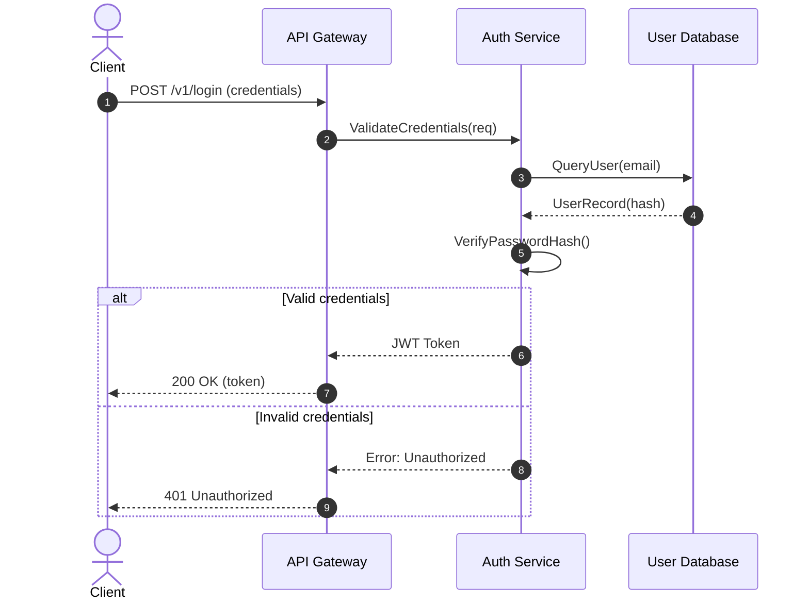
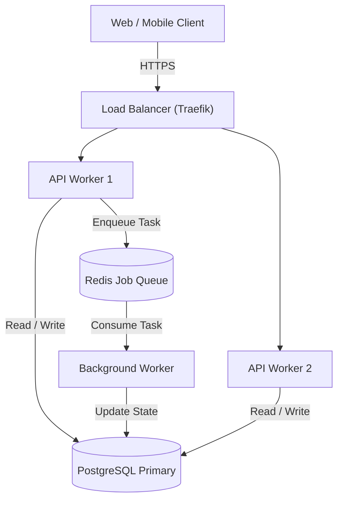
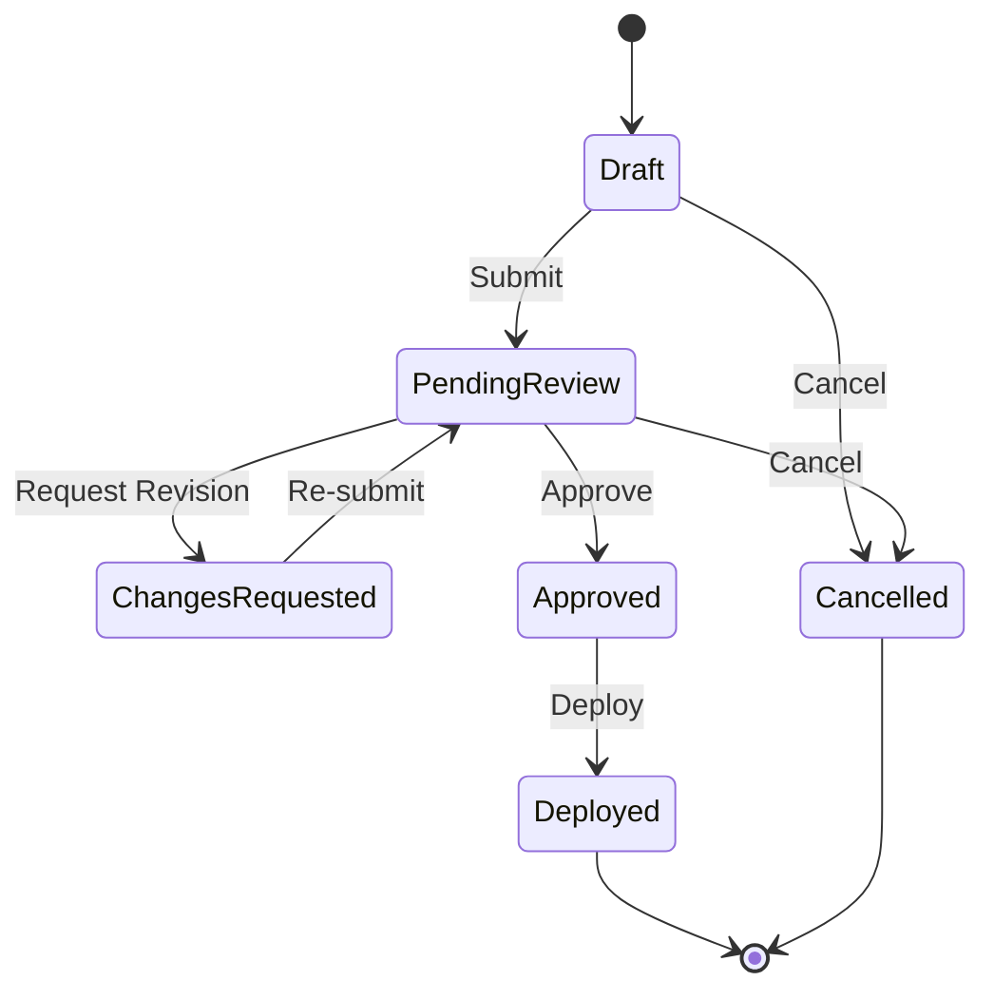
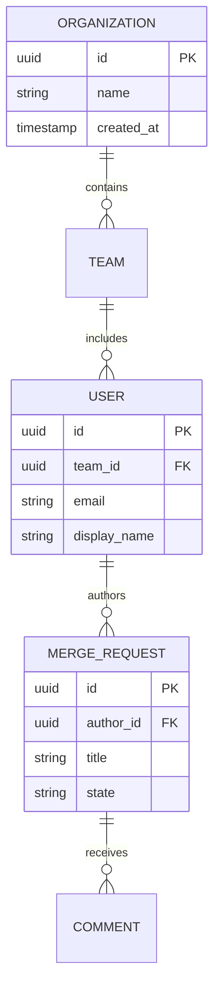

# Mermaid Diagram Guidelines

Mermaid diagrams provide maintainable, text-based visual architecture in Markdown. They render natively in GitLab, GitHub, and docs-as-code documentation engines.

## 1. Core Principles

- Keep diagrams focused: A diagram should answer one architectural or flow question. Do not crowd a single diagram with every database table and helper function.
- Readable direction: Use top-to-bottom (`TD` or `TB`) for hierarchies and component architectures. Use left-to-right (`LR`) for pipelines and timelines.
- Clean node labels: Always use quoted strings inside brackets (e.g., `id["Label Text"]`) to avoid syntax breaks caused by special characters or parentheses.
- Maintainability: Prefer standard Mermaid node shapes (`[...]`, `(...)`, `[(...)]`) over custom CSS styles.

---

## 2. Common Diagram Patterns

### Sequence Diagram (API & Auth Flow)

Use sequence diagrams to show interactions between actors, services, and external APIs over time.

````markdown

````

### Architecture / Component Diagram

Use flowcharts to illustrate component topologies, services, message queues, and databases.

````markdown

````

### State Machine Diagram

Use state diagrams to document lifecycle transitions for tasks, jobs, orders, or connections.

````markdown

````

### Entity Relationship (ER) Diagram

Use ER diagrams to document data models, foreign key relationships, and cardinalities.

````markdown

````

---

## 3. Best Practices Checklist

- Test rendering: Ensure brackets, parentheses, and quotes are balanced.
- Clear naming: Use distinct alphanumeric node identifiers (e.g., `gw`, `db_auth`) separate from the visible label.
- Meaningful edge labels: Label arrows with protocol, method, or payload description (e.g., `-->|gRPC|`, `-->|JSON|`).
